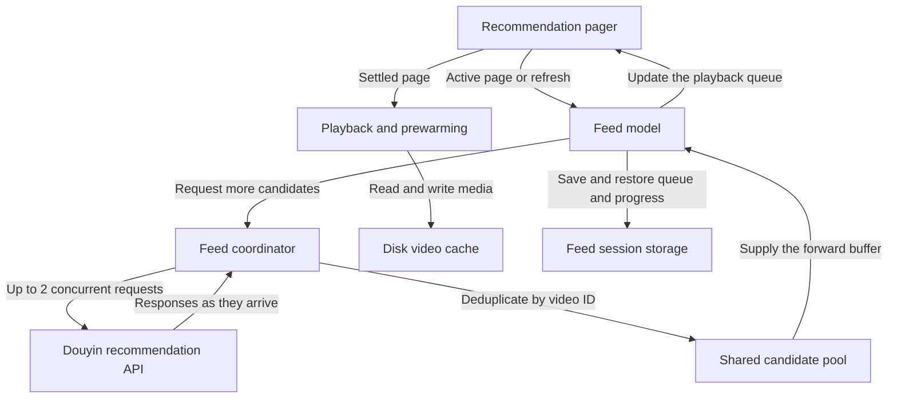

# DouDuo

DouDuo is an unofficial Douyin client for iPhone, including foldable displays, and iPad. It uses SwiftUI for the interface and AVPlayer for video playback, with VLC support.

## Features

- **Recommendations, Following, and Live.** Swipe vertically to browse. In Recommendations, the current video keeps playing while you drag. Playback switches after you release and paging settles.
- **Classic and Immersive layouts.** Switch from **More → Settings → Interface Layout** in Recommendations. Immersive puts actions in a separate right column and overlays the author and caption on the media. The app adapts to portrait, landscape, and inner and outer displays, with side-by-side comments where supported. [Layout details](docs/feed-layout-ab.md)
- **Playback controls.** Tap to pause, double-tap to like, swipe horizontally to seek, or hold for faster playback. Playback speed lock, optional background audio, and lock-screen controls are available.
- **Discovery and interaction.** Search, author profiles, likes, collections, threaded comments, on-screen comments, sharing with friends, messages, watch history, and Watch Later. Live includes a followed-host strip and chat. Account actions require sign-in.

## Recommendation feed architecture



### Workers and scheduling

A worker represents one in-flight recommendation request. The coordinator assigns request sequence numbers and merges responses in arrival order.

| Setting | Current behavior |
| --- | --- |
| Default concurrency | 2 in-flight requests |
| Refill threshold | Refill below 8 upcoming items across the queue and candidate pool, targeting 20 |
| Candidate pool | Up to 80 video metadata records |
| Forward buffer | About 6 items after the current video |
| Request limits | Up to 8 per refill round and 24 per minute |
| Empty pages and failures | Pause background refill for 20 seconds after 3 pages add nothing new. Apply exponential backoff on failed rounds. |
| Timeouts | Free the request slot and accept late responses during the grace period |

Debug builds support `DOUDUO_FEED_WORKERS` values of `1`, `2`, and `4`. Set `DOUDUO_FEED_SERIAL=1` to force serial requests. [Pipeline details and benchmarks](docs/feed-pipeline.md)

### Prewarming and caching

- The candidate pool stores metadata. The preloader prepares AVPlayer for the next 3 items, dropping to 2 or 1 as the device heats up.
- With disk caching enabled, the cache prioritizes the current video and the next 2. Swiping back reuses cached media when available.
- Feed sessions save the recommendation queue and playback progress for restoration on launch.

## Local development

Open `DouDuo.xcodeproj` in Xcode with an SDK that supports the Duo APIs used by the project. Run `./scripts/fetch-vlckit.sh` if you need the local VLC dependency. The feed pipeline tests run without a simulator or network access.

```sh
./scripts/test_feed_pipeline.sh
```

[Screenshots](docs/screenshots/README.md) · [Privacy](PRIVACY.md) · [MIT License](LICENSE)
